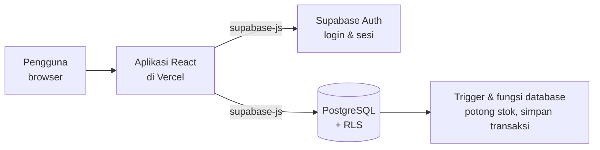

# ☕ Kopipintar — Smart POS & AI Inventory Forecast

Aplikasi kasir (Point of Sale), manajemen stok, dan prediksi kebutuhan stok untuk **kedai kopi UMKM**.

Kopipintar membantu pemilik kedai menjawab tiga pertanyaan sehari-hari:

1. **Apa yang terjual hari ini?** (kasir, riwayat transaksi, laporan)
2. **Stok apa yang hampir habis?** (inventaris, peringatan stok minimum)
3. **Kapan harus belanja lagi, dan berapa banyak?** (prediksi stok habis + draft Purchase Order)

> Status: proyek kompetisi/demo. Lihat bagian [Keterbatasan](#-keterbatasan-saat-ini) sebelum dipakai untuk bisnis sungguhan.

---

## 📑 Daftar Isi

- [Fitur](#-fitur)
- [Peran pengguna](#-peran-pengguna)
- [Cara kerja singkat](#-cara-kerja-singkat)
- [Teknologi](#-teknologi)
- [Struktur folder](#-struktur-folder)
- [Menjalankan di komputer sendiri](#-menjalankan-di-komputer-sendiri)
- [Menyiapkan Supabase](#-menyiapkan-supabase)
- [Login Google (opsional)](#-login-google-opsional)
- [Deploy ke Vercel](#-deploy-ke-vercel)
- [Perintah yang tersedia](#-perintah-yang-tersedia)
- [Keamanan](#-keamanan)
- [Keterbatasan saat ini](#-keterbatasan-saat-ini)
- [Pemecahan masalah](#-pemecahan-masalah)

---

## ✨ Fitur

| Area | Yang bisa dilakukan |
| --- | --- |
| **Login** | Username atau email + password lewat Supabase Auth, opsi "Ingat saya" (hanya menyimpan username), dan login Google |
| **Kasir (POS)** | Keranjang, catatan per item, metode bayar, tombol uang cepat, hitung kembalian, struk, cetak, validasi stok, tampilan responsif (HP, tablet, desktop) |
| **Inventaris** | Tambah/ubah/hapus produk, penyesuaian stok, pemilih ikon (Lucide), kategori, supplier |
| **Produk Paket (Bundle)** | Satu produk jual yang terdiri dari beberapa bahan. Saat paket terjual, **stok bahan penyusunnya yang berkurang**, bukan stok paketnya |
| **AI Forecast** | Menghitung rata-rata penjualan harian, memprediksi tanggal stok habis, memberi tingkat risiko (Tinggi / Sedang / Aman), dan menjelaskan alasannya |
| **Purchase Order** | Ubah rekomendasi forecast menjadi draft pesanan ke supplier |
| **Supplier** | Kelola data pemasok dan lead time |
| **Laporan** | Grafik penjualan dan ekspor CSV |
| **Pengaturan & Bantuan** | Info akun dan pusat bantuan |

---

## 👥 Peran pengguna

| Peran | Akses |
| --- | --- |
| **Admin** | Semua menu: Dashboard, POS, Inventaris, Forecast, Purchase Order, Supplier, Laporan, Pengaturan, Bantuan |
| **Kasir** | Hanya halaman POS |
| **Pending** | Akun baru (misalnya yang login pertama kali dengan Google). **Belum punya akses data apa pun** sampai admin menyetujuinya |

Peran dibaca dari kolom `profiles.role` di database. Pembatasan akses dijaga oleh **Row Level Security (RLS)** di PostgreSQL, bukan hanya oleh tampilan.

Cara menyetujui akun baru (jalankan di Supabase → SQL Editor, ganti emailnya):

```sql
update public.profiles
set role = 'kasir'   -- atau 'admin'
where id = (select id from auth.users where email = 'email@contoh.com');
```

---

## 🔄 Cara kerja singkat

Tidak ada server backend sendiri. Browser langsung berbicara dengan Supabase.



Beberapa hal penting:

- **Checkout** memanggil fungsi database `create_pos_sale`. Fungsi ini memeriksa stok dan harga, lalu menyimpan transaksi beserta item-itemnya dalam satu langkah (atomik). Trigger database yang mengurangi stok, sehingga koneksi yang putus di tengah jalan tidak merusak angka stok.
- **Produk paket**: trigger mengurangi stok bahan penyusun sesuai tabel `bundle_items`.
- **Keamanan data** dijaga RLS. Kunci `anon` yang ada di browser memang publik; yang membatasi akses adalah kebijakan RLS.

---

## 🧰 Teknologi

- **Tampilan:** Vite, React 19, TypeScript, Tailwind CSS, Recharts (grafik), Lucide (ikon)
- **Login & data:** Supabase Auth, PostgreSQL, RLS, `@supabase/supabase-js`
- **Pengujian:** Vitest
- **Hosting:** Vercel (situs statis)
- **Package manager:** pnpm

---

## 🗂️ Struktur folder

```text
smart-pos-ai/
├── client/                  ← Aplikasi yang tampil di browser (inilah yang di-deploy)
│   ├── index.html           ← Titik masuk HTML
│   ├── public/              ← File statis
│   └── src/
│       ├── main.tsx         ← Titik masuk React
│       ├── App.tsx          ← Pengaturan halaman/rute
│       ├── index.css        ← Gaya global Tailwind
│       ├── pages/
│       │   └── Home.tsx     ← Halaman utama: Login, Dashboard, POS, Inventaris,
│       │                      Forecast, Laporan, Purchase Order, Supplier, Pengaturan
│       ├── lib/
│       │   ├── supabase.ts  ← Koneksi Supabase + fungsi baca/tulis data
│       │   └── supabase.frontend.test.ts ← Tes koneksi Supabase (dilewati jika .env kosong)
│       ├── components/      ← Komponen UI yang dipakai ulang (termasuk components/ui)
│       ├── contexts/        ← React context
│       └── hooks/           ← Custom hooks
│
├── supabase/                ← Skema & migrasi database (dijalankan di Supabase SQL Editor)
│   ├── schema.sql                 ← Tabel utama
│   ├── functional_features.sql    ← Fitur operasional (supplier, purchase order, dll.)
│   ├── icon_name_migration.sql    ← Kolom ikon produk
│   ├── bundle_migration.sql       ← Produk paket + trigger stok bahan
│   ├── static_frontend.sql        ← Fungsi checkout, profil "pending", kebijakan RLS
│   ├── reporting.sql              ← Agregat laporan, demand, dan penerimaan PO atomik
│   └── seed_demo_sales.sql        ← Opsional: transaksi demo bertanda DEMO-
│
├── scripts/                 ← Skrip bantuan yang dijalankan manual di komputer
│   ├── db-setup.js          ← Membuat tabel + data contoh (aman dijalankan ulang)
│   ├── create-users.js      ← Membuat akun admin & kasir lewat Supabase Admin API
│   └── package-deploy.mjs   ← Membuat ZIP siap deploy
│
├── shared/                  ← Logika kasir yang dipakai bersama (pos.ts) dan tesnya (pos.test.ts)
├── patches/                 ← Patch dependency (jangan dihapus; dipakai pnpm)
│
├── vercel.json              ← Konfigurasi Vercel (semua rute diarahkan ke index.html)
├── vite.config.ts           ← Konfigurasi build (hasil build ke dist/public)
├── vitest.config.ts         ← Konfigurasi pengujian
├── package.json             ← Daftar dependency dan perintah
├── pnpm-lock.yaml           ← Penguncian versi dependency
│
├── .env.example             ← Contoh variabel lingkungan (tanpa rahasia)
├── README.md                ← Dokumen ini
└── docs/                    ← Panduan tambahan
    ├── SUPABASE_SETUP.md          ← Panduan setup Supabase
    ├── SUPABASE_FRONTEND_SETUP.md ← Setup Supabase untuk frontend statis (termasuk Google)
    └── DATABASE_DARI_NOL.md       ← Panduan membuat database dari nol
```

> **Mau mulai membaca kode?** Buka `client/src/lib/supabase.ts` (cara aplikasi bicara ke database), lalu `client/src/pages/Home.tsx` (semua halaman), lalu `supabase/static_frontend.sql` (aturan keamanan dan logika checkout).

---

## 💻 Menjalankan di komputer sendiri

### Yang dibutuhkan

- [Node.js](https://nodejs.org) 20 atau lebih baru
- pnpm (`npm install -g pnpm`, atau `corepack enable`)
- Project Supabase (gratis di [supabase.com](https://supabase.com))

### Langkah

1. Unduh kode (`git clone https://github.com/gheageltraa/smart-pos-ai.git`) lalu masuk ke foldernya.
2. Pasang dependency:
   ```bash
   pnpm install
   ```
3. Salin `.env.example` menjadi `.env`, lalu isi dua nilai dari Supabase (Project Settings → API):
   ```text
   VITE_SUPABASE_URL=https://PROJECT_ID.supabase.co
   VITE_SUPABASE_ANON_KEY=kunci-anon-publik
   ```
4. Siapkan database (lihat bagian berikut).
5. Jalankan:
   ```bash
   pnpm dev
   ```
   Buka alamat yang muncul di terminal, biasanya `http://localhost:5173`.

---

## 🗄️ Menyiapkan Supabase

Pilih **salah satu** jalur untuk database baru. Jangan mencampur keduanya.

### Jalur A — Lewat SQL Editor (paling mudah dipahami)

Di Supabase → **SQL Editor**, jalankan file berikut **berurutan**:

1. `supabase/schema.sql`
2. `supabase/functional_features.sql`
3. `supabase/icon_name_migration.sql`
4. `supabase/bundle_migration.sql`
5. `supabase/static_frontend.sql`
6. `supabase/reporting.sql`
7. (Opsional, hanya untuk demo) `supabase/seed_demo_sales.sql`

`reporting.sql` menghormati RLS; laporan mengelompokkan tanggal dalam zona
Asia/Jakarta. Revenue dan profit bundle tetap tercatat pada produk bundle yang
terjual, sementara kebutuhan komponennya ikut dihitung untuk forecasting dan
stok. Fungsi penerimaan PO hanya untuk Admin dan menambah stok sekali.

Untuk database yang sudah memakai versi lama, jalankan ulang
`static_frontend.sql`, lalu `reporting.sql`. Ini memperbarui fungsi checkout
dan memasang fungsi laporan serta penerimaan purchase order.

Jalankan `seed_demo_sales.sql` hanya jika dibutuhkan untuk demo. Baris yang
dibuat memakai nomor transaksi `DEMO-`, tidak mengurangi stok, dan dapat
dihapus terpisah memakai instruksi komentar di file tersebut.

### Jalur B — Lewat skrip

`pnpm db:setup` membuat tabel dan data contoh. Skrip ini butuh `SUPABASE_DB_URL` (connection string database) **hanya di terminal saat setup**. Setelah itu tetap jalankan `supabase/static_frontend.sql` di SQL Editor.

### Membuat akun admin dan kasir

Skrip ini memakai kunci rahasia, jadi isi variabelnya **hanya di terminal**, jangan di file `.env` yang masuk Git.

PowerShell (Windows):

```powershell
$env:SUPABASE_URL="https://PROJECT_ID.supabase.co"
$env:SUPABASE_SERVICE_ROLE_KEY="kunci-service-role"
pnpm auth:seed
```

macOS / Linux:

```bash
SUPABASE_URL="https://PROJECT_ID.supabase.co" \
SUPABASE_SERVICE_ROLE_KEY="kunci-service-role" \
pnpm auth:seed
```

Akun demo yang dibuat skrip ini hanya untuk percobaan. **Ganti passwordnya sebelum aplikasi dipublikasikan.**

---

## 🔐 Login Google (opsional)

1. **Google Cloud Console** → APIs & Services → Credentials → buat *OAuth client ID* tipe *Web application*.
   - Authorized JavaScript origins: `http://localhost:5173` dan alamat Vercel kamu.
   - Authorized redirect URI: `https://PROJECT_ID.supabase.co/auth/v1/callback`
2. **Supabase** → Authentication → Providers → **Google**: aktifkan, isi Client ID dan Client Secret.
3. **Supabase** → Authentication → URL Configuration:
   - Site URL: alamat Vercel kamu.
   - Redirect URLs: `http://localhost:5173/**` dan `https://alamat-vercel-kamu.vercel.app/**`

Client Secret **hanya** dimasukkan di dashboard Supabase, tidak pernah di kode atau di Vercel.

Akun Google baru masuk sebagai **pending** dan harus disetujui admin (lihat [Peran pengguna](#-peran-pengguna)).

---

## 🚀 Deploy ke Vercel

1. Hubungkan repositori GitHub ke Vercel.
2. Pengaturan build:
   - **Build Command:** `pnpm build`
   - **Output Directory:** `dist/public`
3. Tambahkan **hanya** dua environment variable ini (Production dan Preview):
   ```text
   VITE_SUPABASE_URL=https://PROJECT_ID.supabase.co
   VITE_SUPABASE_ANON_KEY=kunci-anon-publik
   ```
4. Redeploy setelah mengubah variabel (nilai `VITE_*` ditanam saat build).
5. Tambahkan alamat Vercel ke Redirect URLs di Supabase (dan ke Google Cloud jika memakai login Google).

---

## 🧪 Perintah yang tersedia

| Perintah | Fungsi |
| --- | --- |
| `pnpm dev` | Menjalankan aplikasi untuk pengembangan |
| `pnpm check` | Memeriksa tipe TypeScript |
| `pnpm test` | Menjalankan pengujian Vitest |
| `pnpm build` | Membuat versi produksi di `dist/public` |
| `pnpm db:setup` | Membuat tabel dan data contoh (butuh `SUPABASE_DB_URL`) |
| `pnpm auth:seed` | Membuat akun admin dan kasir (butuh kunci service role) |
| `pnpm package:zip` | Membuat ZIP siap deploy |

---

## 🛡️ Keamanan

- **Boleh ada di browser / Vercel:** `VITE_SUPABASE_URL` dan `VITE_SUPABASE_ANON_KEY`.
- **Tidak boleh di browser, di Vercel, atau di GitHub:** kunci *service role*, `SUPABASE_DB_URL`, password database, dan Client Secret Google.
- File `.env` sudah diabaikan oleh Git (`.gitignore`). Jangan memaksa meng-commit-nya.
- Jika sebuah rahasia sempat ter-commit atau tersebar, **buat ulang (rotate) kuncinya** di Supabase atau Google Cloud.
- Semua akses data dibatasi RLS berdasarkan peran. Akun `pending` tidak bisa membaca atau menulis data operasional.
- Sebelum dipakai secara komersial, tambahkan: audit log, manajemen peran per outlet yang lebih rinci, dan peninjauan keamanan.

---

## ⚠️ Keterbatasan saat ini

1. **Pembayaran QRIS dan Debit** masih berupa simulasi, belum terhubung ke payment gateway sungguhan.
2. **Cetak struk** memakai `window.print()` browser, belum terhubung ke printer thermal tertentu.
3. **Scan barcode** belum terhubung ke perangkat scanner.
4. **AI Forecast** memakai perhitungan statistik dari riwayat penjualan, bukan model machine learning.
5. **Laporan:** grafik, ringkasan profit, kategori, produk terlaris, dan metode pembayaran dibaca dari transaksi Supabase pada rentang tanggal terpilih. Biaya operasional tidak tersedia di skema sehingga tidak dihitung sebagai laba bersih.
6. Dukungan **multi-outlet** masih dasar.
7. Cocok untuk kompetisi dan demo; perlu penguatan keamanan sebelum dipakai komersial.

---

## 🩺 Pemecahan masalah

| Masalah | Penyebab umum | Solusi |
| --- | --- | --- |
| `Unsupported provider: provider is not enabled` | Login Google belum diaktifkan di Supabase | Aktifkan provider Google dan isi Client ID/Secret |
| `redirect_uri_mismatch` dari Google | Callback URL di Google Cloud tidak sama persis | Salin ulang Callback URL dari halaman provider Google di Supabase |
| Halaman kosong atau 404 setelah deploy | Output Directory salah atau rewrite hilang | Pastikan `dist/public` dan `vercel.json` ada rewrite ke `/index.html` |
| Setelah login Google tidak ada menu | Akun masih `pending` | Setujui akun lewat SQL di bagian Peran pengguna |
| Data tidak muncul / error izin | Migrasi SQL belum dijalankan | Jalankan `supabase/static_frontend.sql` |
| `Set SUPABASE_URL and SUPABASE_SERVICE_ROLE_KEY` | Skrip tidak membaca `.env` | Isi variabel di terminal sebelum menjalankan skrip |
| Variabel baru di Vercel tidak berpengaruh | Nilai `VITE_*` ditanam saat build | Redeploy setelah mengubah variabel |

---

Dibuat untuk membantu UMKM kedai kopi mengelola kasir, stok, dan pembelian dengan lebih cerdas. ☕